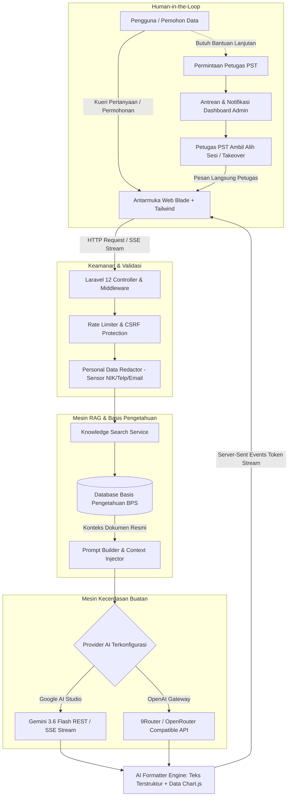

# 🏛️ Portal Layanan Statistik Terpadu (PST) & Asisten AI
### Badan Pusat Statistik Kabupaten Karanganyar

[](https://laravel.com)
[](https://php.net)
[](https://tailwindcss.com)
[](https://ai.google.dev/)
[](LICENSE)
[](#)

---

## 📌 Ringkasan Eksekutif

**Portal Layanan Statistik Terpadu (PST) & Asisten AI BPS Kabupaten Karanganyar** adalah platform pelayanan publik digital modern yang menggabungkan kecerdasan buatan berbasis *Retrieval-Augmented Generation* (RAG) dengan tata kelola data statistik resmi pemerintah. 

Platform ini dirancang untuk menjawab tantangan aksesibilitas data bagi masyarakat, akademisi, peneliti, jurnalis, serta pemangku kebijakan daerah melalui interaksi percakapan cerdas yang teruji akurasinya (*grounded*), ramah pengguna, berstandar keamanan tinggi, dan beroperasi 24 jam sehari.

---

## 📑 Daftar Isi

- [Arsitektur Sistem & Alur Kerja](#-arsitektur-sistem--alur-kerja)
- [Fitur Utama](#-fitur-utama)
- [Matriks Teknologi](#-matriks-teknologi)
- [Prasyarat Sistem](#-prasyarat-sistem)
- [Panduan Instalasi Lokal (Quick Start)](#-panduan-instalasi-lokal-quick-start)
- [Konfigurasi Lingkungan (`.env`)](#-konfigurasi-lingkungan-env)
- [Akun Pengguna Awal (Default Credentials)](#-akun-pengguna-awal-default-credentials)
- [Alur Kerja Pengembangan & Skrip Perintah](#-alur-kerja-pengembangan--skrip-perintah)
- [Panduan Deployment Production](#-panduan-deployment-production)
- [Keamanan & Privasi Data](#-keamanan--privasi-data)
- [Struktur Direktori Proyek](#-struktur-direktori-proyek)
- [Kontribusi & Lisensi](#-kontribusi--lisensi)

---

## 📐 Arsitektur Sistem & Alur Kerja

Platform ini mengadopsi pola arsitektur *clean layered service* di atas Laravel 12, dengan alur kerja pemrosesan data cerdas sebagai berikut:



---

## ✨ Fitur Utama

### 1. 🤖 AI Statistical Consultant dengan Engine RAG
- **Grounding Data Resmi BPS**: Jawaban dipandu langsung oleh basis pengetahuan kurasi BPS Karanganyar (Indeks Pembangunan Manusia, Kemiskinan, PDRB, Inflasi, Ketenagakerjaan, Pertanian, dan Kependudukan).
- **Streaming Token Real-Time**: Respons percakapan dialirkan kata-demi-kata menggunakan teknologi *Server-Sent Events* (SSE) untuk latensi awal yang minimal.
- **Visualisasi Grafik Otomatis**: AI mampu menghasilkan struktur data yang secara otomatis dirender menjadi bagan visual interaktif (*Chart.js*) langsung pada balon percakapan.
- **Sensor Data Sensitif Otomatis (PII Redaction)**: Setiap input disaring secara terprogram sebelum dikirim ke API eksternal guna melindungi NIK, nomor telepon, dan alamat email pemohon.

### 2. 👥 Human-in-the-Loop & Live Agent Handoff
- **Alih Kelola Petugas Real-Time**: Pemohon dapat meminta bantuan petugas resmi PST secara langsung apabila kueri memerlukan validasi khusus.
- **Dasbor Konsol Antrean Petugas**: Petugas dapat melihat daftar antrean sesi aktif, mengambil alih percakapan (*take over*), membalas pesan secara instan, dan menutup sesi setelah layanan tuntas.

### 3. 🗺️ Peta Tematik & Indikator Wilayah Karanganyar
- **Eksplorasi 17 Kecamatan**: Visualisasi data wilayah se-Kabupaten Karanganyar yang menyajikan metrik statistik utama per kecamatan dalam bentuk antarmuka visual responsif.

### 4. 🧮 Kalkulator Statistik Terapan
- **Kalkulator Sampel Slovin**: Menghitung jumlah sampel representatif untuk keperluan penelitian dengan batas ketelitian (*margin of error*) yang dapat disesuaikan.
- **Kalkulator Proyeksi Penduduk**: Estimasi laju pertumbuhan penduduk menggunakan metode geometrik dan eksponensial.
- **Kalkulator Laju Inflasi**: Perhitungan perubahan Indeks Harga Konsumen (IHK) antar periode waktu.

### 5. 🛡️ Kanal Layanan Aduan & Aspirasi Publik
- **Penomoran Tiket Otomatis**: Setiap pengaduan publik memperoleh kode unik (`TKT-YYYYMMDD-XXXX`) untuk memantau proses verifikasi secara transparan.
- **Audit Trail Status Pengaduan**: Pelacakan riwayat status bertahap (*Diterima*, *Diverifikasi*, *Ditindaklanjuti*, hingga *Selesai*).
- **Unggah Lampiran Aman**: Penyimpanan berkas pendukung dengan validasi ekstensi ketat dan isolasi direktori privat.

### 6. 🌐 Inklusivitas & Aksesibilitas
- **Penerjemahan Multibahasa Dinamis**: Terintegrasi dengan Google Cloud Translation Engine untuk menyajikan antarmuka dan respon dalam 80+ bahasa dunia (termasuk Basa Jawa Krama Alus).
- **Dukungan Web Speech**: Dilengkapi fitur *Speech-to-Text* (perekaman suara mikrofon) dan *Text-to-Speech* (pembaca suara audio) ramah aksesibilitas.

### 7. 📄 Pelaporan & Ekspor Dokumen Resmi
- **Bukti Konsultasi PDF**: Pemohon dapat mengunduh rangkuman hasil konsultasi statistik ber-KOP resmi instansi.
- **Rekapitulasi Layanan Admin**: Pencetakan laporan rekap operasional layanan dan pengaduan berkala menggunakan *Barryvdh DomPDF*.

---

## 🛠️ Matriks Teknologi

| Layer | Komponen / Library | Peran & Keterangan |
| :--- | :--- | :--- |
| **Backend Framework** | [Laravel 12](https://laravel.com) | Core application framework (PHP 8.2+) |
| **Frontend & Styling** | [Tailwind CSS 3.x](https://tailwindcss.com) & Blade | Antarmuka responsif, modern, dan modular |
| **Ikonografi** | [Iconify](https://iconify.design) (Lucide Icons) | Visual ikon clean dan seragam |
| **Visualisasi Data** | [Chart.js](https://www.chartjs.org) | Render grafik statistik dinamis |
| **Mesin AI & LLM** | Google AI Studio (Gemini 3.6 Flash) | Model inferensi natural language & reasoning |
| **Gateway Alternatif** | OpenAI-Compatible API (9Router / OpenRouter) | Opsi fleksibel untuk fallback AI gateway |
| **Basis Data** | SQLite / MySQL 8.0+ / MariaDB 10.6+ | Penyimpanan relasional terstruktur |
| **Penerjemah** | Google Cloud Translation API | Lokalisasi lintas bahasa dinamis |
| **Generator PDF** | [barryvdh/laravel-dompdf](https://github.com/barryvdh/laravel-dompdf) | Penyusunan lembar laporan berformat resmi A4 |
| **Otentikasi & Keamanan**| Laravel Breeze & Socialite (Google SSO) | Manajemen sesi pengguna dan Single Sign-On |

---

## 💻 Prasyarat Sistem

Sebelum melakukan instalasi, pastikan lingkungan server atau komputer lokal Anda telah memenuhi spesifikasi berikut:

- **PHP**: Versi **8.2** atau **8.3**
  - Ekstensi PHP wajib: `bcmath`, `curl`, `dom`, `fileinfo`, `gd` / `imagick`, `mbstring`, `openssl`, `pdo_sqlite` atau `pdo_mysql`, `tokenizer`, `xml`.
- **Composer**: Versi **2.x**
- **Node.js**: Versi **18.x** atau **20.x LTS** & **NPM**
- **Basis Data**: SQLite (bawaan lokal) atau MySQL 8.0 / MariaDB 10.6+

---

## 🚀 Panduan Instalasi Lokal (Quick Start)

Ikuti langkah-langkah terstruktur berikut untuk mengonfigurasi proyek di lingkungan lokal:

### 1. Kloning Repositori
```bash
git clone https://github.com/faizarfi/aichatbotbps.git
cd aichatbotbps
```

### 2. Pasang Dependensi Backend & Frontend
```bash
# Dependensi PHP Composer
composer install

# Dependensi Node.js / NPM
npm install
```

### 3. Konfigurasi Berkas Lingkungan
Salin berkas template lingkungan dan buat kunci enkripsi aplikasi:
```bash
cp .env.example .env
php artisan key:generate
```

### 4. Konfigurasi Kunci AI
Buka berkas `.env` dan masukkan API Key dari Google AI Studio:
```dotenv
AI_PROVIDER=gemini
AI_BASE_URL=https://generativelanguage.googleapis.com/v1beta
AI_API_KEY=AIzaSy...your_gemini_api_key...
AI_MODEL=gemini-3.6-flash
```

### 5. Migrasi Database & Seeder Data Awal
Jalankan migrasi skema tabel beserta basis pengetahuan statistik dan akun awal:
```bash
# Menjalankan migrasi beserta seeder
php artisan migrate --seed

# Menghubungkan direktori penyimpanan publik
php artisan storage:link
```

### 6. Jalankan Server Pengembangan
Gunakan skrip `composer run dev` untuk menjalankan server HTTP Laravel, Vite development server, dan queue worker secara simultan:
```bash
composer run dev
```

Aplikasi siap diakses melalui peramban web pada alamat:
👉 **`http://127.0.0.1:8000`**

---

## ⚙️ Konfigurasi Lingkungan (`.env`)

Berikut adalah parameter konfigurasi esensial yang dapat disesuaikan pada berkas `.env`:

| Variabel | Tipe | Nilai Bawaan / Contoh | Penjelasan |
| :--- | :--- | :--- | :--- |
| `APP_NAME` | String | `"BPS Karanganyar"` | Nama aplikasi pada judul halaman & email |
| `APP_ENV` | String | `local` / `production` | Mode lingkungan aplikasi |
| `APP_URL` | URL | `http://127.0.0.1:8000` | Alamat dasar protokol web |
| `DB_CONNECTION` | String | `sqlite` / `mysql` | Driver basis data yang aktif |
| `AI_PROVIDER` | String | `gemini` | Pilihan provider AI (`gemini` atau `openai`) |
| `AI_BASE_URL` | URL | `https://generativelanguage.googleapis.com/v1beta` | Endpoint API model AI |
| `AI_API_KEY` | String | *[API Key Anda]* | Kunci akses API AI Studio atau Gateway |
| `AI_MODEL` | String | `gemini-3.6-flash` | Nama model inferensi LLM |
| `AI_TIMEOUT` | Integer | `45` | Batas waktu tunggu respons API (detik) |
| `ADMIN_EMAIL` | Email | `admin@bps-karanganyar.local` | Email administrator awal (saat seeder) |
| `ADMIN_PASSWORD` | String | `password` | Kata sandi administrator awal |

---

## 👤 Akun Pengguna Awal (Default Credentials)

Saat menjalankan `php artisan db:seed`, sistem membuat akun administrator default:

- **URL Login Admin**: `/login` (atau `/admin/login`)
- **Email**: `admin@bps-karanganyar.local`
- **Password**: `password`
- **Role**: `admin` *(Memiliki hak akses penuh ke seluruh manajemen data & konfigurasi)*

> ⚠️ **Penting untuk Lingkungan Production**: Segera ubah kredensial default ini melalui panel admin setelah proses deployment selesai.

---

## 🔄 Alur Kerja Pengembangan & Skrip Perintah

Proyek ini telah dikonfigurasi dengan utilitas pengembangan modern untuk memastikan konsistensi kode:

```bash
# Menjalankan server aplikasi lengkap (Laravel + Vite + Queue Worker)
composer run dev

# Menjalankan pengujian otomatis (Unit & Feature Test)
composer run test

# Menjalankan standarisasi kode PHP menggunakan Laravel Pint
./vendor/bin/pint

# Melakukan kompilasi aset frontend untuk keperluan production
npm run build

# Membersihkan dan menyusun ulang cache konfigurasi
php artisan optimize:clear
```

---

## 🌐 Panduan Deployment Production

Untuk panduan komprehensif mengenai pemasangan di **Virtual Private Server (VPS)** berbasis Linux Ubuntu (konfigurasi Nginx, Let's Encrypt SSL, Supervisor Queue Worker, Cron Scheduler, serta CI/CD Webhook otomatis), silakan merujuk pada dokumentasi operasional:

👉 **[BACA PANDUAN LENGKAP DEPLOYMENT VPS (DEPLOYMENT_VPS.md)](./DEPLOYMENT_VPS.md)**

---

## 🔒 Keamanan & Privasi Data

Aplikasi ini mengedepankan prinsip kehati-hatian dalam perlindungan data publik:

1. **Penyaringan Identitas Pribadi (PII Redaction)**: Modul `PersonalDataRedactor` secara aktif mendeteksi dan menyamarkan angka berformat NIK (16 digit), nomor telepon, dan format surel sebelum diteruskan ke model bahasa pihak ketiga.
2. **Mitigasi Serangan Siber**: Dilengkapi proteksi bawaan Laravel terhadap serangan CSRF (*Cross-Site Request Forgery*), XSS (*Cross-Site Scripting*), serta SQL Injection via PDO parameter binding.
3. **Pembatasan Laju Kueri (Rate Limiting)**: Rute publik seperti `/chat/message` dan `/aduan` dilindungi dengan middleware `throttle` bertingkat untuk mencegah penyalahgunaan kuota (*abuse/DDoS*).
4. **Validasi Berkas Ketat**: Lampiran pengaduan melalui proses verifikasi tipe MIME dan ukuran maksimum sebelum disimpan pada direktori yang terlindungi.

---

## 📂 Struktur Direktori Proyek

```plaintext
aichatbotbps/
├── app/
│   ├── Http/
│   │   ├── Controllers/
│   │   │   ├── Admin/             # Controller panel administrasi & petugas
│   │   │   ├── PublicChatController.php # Manajemen sesi percakapan chatbot publik
│   │   │   ├── ComplaintController.php  # Penanganan layanan aduan masyarakat
│   │   │   ├── DistrictStatisticController.php # Modul peta tematik kecamatan
│   │   │   └── CalculatorController.php # Modul kalkulator statistik
│   │   └── Middleware/            # Middleware otorisasi & role verification
│   ├── Models/                    # Eloquent models (Conversation, Complaint, Article, dll.)
│   └── Services/
│       ├── AiLlmService.php       # Integrasi LLM (Gemini / OpenAI Gateway & SSE Stream)
│       ├── KnowledgeSearchService.php # Mesin pencarian basis pengetahuan RAG
│       ├── PersonalDataRedactor.php   # Modul sensor PII (Data sensitif)
│       └── TicketNumberService.php    # Generator tiket aduan unik terformat
├── database/
│   ├── migrations/                # Skema basis data relasional
│   └── seeders/                   # Seeder data awal & basis pengetahuan statistik
├── public/                        # Aset publik & entrypoint aplikasi (index.php)
├── resources/
│   ├── css/                       # Stylesheet Tailwind CSS
│   ├── js/                        # Modul JavaScript (Chart.js, SSE client, Audio)
│   └── views/
│       ├── admin/                 # Tampilan antarmuka dashboard admin & petugas
│       ├── calculators/           # Tampilan antarmuka kalkulator statistik
│       ├── chat/                  # Tampilan chatbot & template PDF konsultasi
│       ├── complaints/            # Tampilan pengajuan & pelacakan status aduan
│       └── districts/             # Tampilan visualisasi peta tematik kecamatan
├── routes/
│   ├── web.php                    # Definisi rute antarmuka publik & rute admin
│   └── auth.php                   # Rute otentikasi sistem Breeze
├── DEPLOYMENT_VPS.md              # SOP resmi panduan deployment server VPS
└── README.md                      # Dokumentasi utama proyek
```

---

## 📄 Kontribusi & Lisensi

Proyek ini dirilis di bawah lisensi terbuka **[MIT License](LICENSE)**.

Dikembangkan dan dikelola untuk mendukung transformasi digital pelayanan statistik:
- **Pengembang**: [Faiz Arfian Ilhami](https://github.com/faizarfi)
- **Instansi**: Badan Pusat Statistik (BPS) Kabupaten Karanganyar
