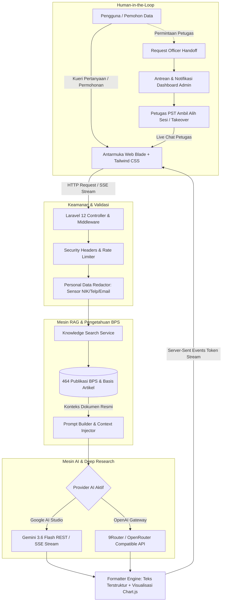

# Portal Layanan Statistik Terpadu (PST) & KARTA AI

## Badan Pusat Statistik Kabupaten Karanganyar

**KARTA** — *Konsultan AI Riset & Terpadu Angka* (MFD: 3313)

[](https://laravel.com)
[](https://php.net)
[](https://tailwindcss.com)
[](https://ai.google.dev/)
[](https://karanganyarkab.bps.go.id)
[](LICENSE)

---

## Ringkasan Eksekutif

**Portal Layanan Statistik Terpadu (PST) & KARTA AI BPS Kabupaten Karanganyar** adalah platform pelayanan publik digital modern yang mengintegrasikan:

1. **KARTA AI (*Konsultan AI Riset & Terpadu Angka*)**: Asisten virtual cerdas berbasis *Retrieval-Augmented Generation* (RAG) dan penalaran *Deep Research*.
2. **Katalog 464 Publikasi Resmi BPS**: Integrasi data publikasi statistik berkala Kabupaten Karanganyar (MFD: 3313) yang tersinkronisasi otomatis via BPS Web API.
3. **Peta Spasial 3D 17 Kecamatan**: Visualisasi data wilayah isometrik 3D interaktif yang menyajikan metrik statistik per kecamatan secara responsif dan dinamis.
4. **Human-in-the-Loop PST Handoff**: Fasilitas konsultasi tatap muka digital di mana permohonan dapat dialihkan secara langsung ke petugas PST BPS.
5. **Keamanan & Privasi Berlapis**: Standar perlindungan data pribadi (PII), enkripsi AES-256 database, mitigasi XSS/CSRF, isolasi berkas, dan *security headers* modern.

---

## Daftar Isi

- [Arsitektur Sistem & Alur Kerja](#arsitektur-sistem--alur-kerja)
- [Fitur Utama](#fitur-utama)
- [Katalog 464 Publikasi & Deep Research](#katalog-464-publikasi--deep-research)
- [Peta Spasial 3D 17 Kecamatan](#peta-spasial-3d-17-kecamatan)
- [Matriks Teknologi](#matriks-teknologi)
- [Prasyarat Sistem](#prasyarat-sistem)
- [Panduan Instalasi Lokal](#panduan-instalasi-lokal)
- [Konfigurasi Lingkungan (.env)](#konfigurasi-lingkungan-env)
- [Akun Pengguna Awal](#akun-pengguna-awal)
- [Alur Kerja Pengembangan & Perintah Artisan](#alur-kerja-pengembangan--perintah-artisan)
- [Keamanan & Privasi Data Warga](#keamanan--privasi-data-warga)
- [Panduan Deployment Production](#panduan-deployment-production)
- [Struktur Direktori Proyek](#struktur-direktori-proyek)
- [Kontribusi & Lisensi](#kontribusi--lisensi)

---

## Arsitektur Sistem & Alur Kerja

Platform ini mengadopsi pola arsitektur *clean layered service* di atas Laravel 12, dengan alur kerja pemrosesan data cerdas sebagai berikut:



---

## Fitur Utama

### 1. KARTA AI: Konsultan Statistik RAG & Deep Research

- **Grounding Data Resmi BPS**: Jawaban dipandu langsung oleh 464 publikasi resmi BPS Kabupaten Karanganyar dan basis pengetahuan statistik (IPM, PDRB, Kemiskinan, Inflasi, Tenaga Kerja, Pertanian, dan Kependudukan).
- **Streaming Token Real-Time**: Respons percakapan dialirkan kata-demi-kata menggunakan teknologi *Server-Sent Events* (SSE) untuk pengalaman interaktif latensi rendah.
- **Visualisasi Grafik Otomatis**: KARTA mampu menghasilkan blok data terstruktur yang otomatis dirender menjadi bagan visual interaktif (*Chart.js*) langsung pada percakapan.
- **Sensor Data Sensitif Otomatis (PII Redaction)**: Setiap input disaring sebelum dikirim ke API eksternal guna melindungi NIK (16 digit), nomor telepon, dan email pemohon.
- **Ekspor Bukti Konsultasi PDF**: Pemohon dapat mengunduh lembar rangkuman hasil konsultasi ber-KOP resmi BPS Karanganyar lengkap dengan rujukan data.

### 2. Human-in-the-Loop & Live Agent Handoff

- **Alih Kelola Petugas Real-Time**: Pemohon dapat meminta bantuan petugas resmi PST secara langsung jika pertanyaan memerlukan konfirmasi atau data khusus.
- **Dasbor Konsol Antrean Petugas**: Petugas dapat memantau antrean percakapan, mengambil alih sesi (*take over*), membalas secara langsung, dan menutup sesi saat selesai.

### 3. Peta Spasial 3D 17 Kecamatan Karanganyar

- **Visualisasi 3D Isometrik**: Mode visualisasi spasial 3D berputar interaktif dan mode 2D peta datar.
- **17 Node Tower Kecamatan**: Visualisasi data wilayah 17 kecamatan se-Kabupaten Karanganyar dengan indikator statistik utama dan drawer profil wilayah.

### 4. Kalkulator Statistik Terapan

- **Kalkulator Sampel Slovin**: Menghitung jumlah sampel representatif untuk penelitian dengan batas ketelitian (*margin of error*) yang dapat disesuaikan.
- **Kalkulator Proyeksi Penduduk**: Estimasi pertumbuhan penduduk dengan metode geometrik dan eksponensial.
- **Kalkulator Laju Inflasi**: Perhitungan perubahan Indeks Harga Konsumen (IHK) antar periode waktu.

### 5. Kanal Layanan Aduan & Aspirasi Publik

- **Penomoran Tiket Otomatis**: Setiap pengaduan publik memperoleh kode unik (`ADU-YYYY-XXXXXX`) untuk memantau proses verifikasi secara transparan.
- **Pelacakan Status Terlindungi**: Status dan timeline aduan dapat dipantau publik dengan deskripsi yang disamarkan (*masked*) guna menjamin kerahasiaan identitas pelapor.
- **Unggah Lampiran Aman**: Penyimpanan berkas pendukung di direktori privat terisolasi dengan validasi ekstensi ketat (PDF, JPG, PNG).

### 6. Inklusivitas & Aksesibilitas

- **Penerjemahan Multibahasa Dinamis**: Terintegrasi dengan Google Translation Engine untuk menyajikan antarmuka dalam berbagai bahasa daerah dan internasional (termasuk Basa Jawa).
- **Dukungan Web Speech**: Dilengkapi fitur *Speech-to-Text* (input suara mikrofon) dan *Text-to-Speech* (suara audio).

---

## Katalog 464 Publikasi & Deep Research

Portal ini dilengkapi dengan modul sinkronisasi otomatis katalog publikasi resmi BPS Kabupaten Karanganyar:

- **Tabel Basis Data**: `publications` menyimpan judul, nomor publikasi, tanggal rilis, abstrak, cover publikasi, dan tautan unduh PDF resmi.
- **Perintah Artisan Sinkronisasi**:

  ```bash
  php artisan bps:sync-publications
  ```

- **Integrasi RAG**: Abstrak dan metadata 464 publikasi diindeks ke dalam mesin pencarian cerdas (`KnowledgeSearchService`), memungkinkan KARTA menjawab pertanyaan spesifik mengenai data Karanganyar Dalam Angka, Statistik Daerah, dan survei sektoral terkini.

---

## Peta Spasial 3D 17 Kecamatan

Peta tematik 17 kecamatan di Kabupaten Karanganyar mencakup seluruh wilayah:

| No | Nama Kecamatan | Kode Wilayah | No | Nama Kecamatan | Kode Wilayah |
| :-: | :--- | :-: | :-: | :--- | :-: |
| 1 | Jatipuro | 3313010 | 10 | Tasikmadu | 3313100 |
| 2 | Jatiyoso | 3313020 | 11 | Jaten | 3313110 |
| 3 | Jumapolo | 3313030 | 12 | Colomadu | 3313120 |
| 4 | Jumantono | 3313040 | 13 | Gondangrejo | 3313130 |
| 5 | Matesih | 3313050 | 14 | Kebakkramat | 3313140 |
| 6 | Tawangmangu | 3313060 | 15 | Mojogedang | 3313150 |
| 7 | Ngargoyoso | 3313070 | 16 | Kerjo | 3313160 |
| 8 | Karangpandan | 3313080 | 17 | Jenawi | 3313170 |
| 9 | Karanganyar | 3313090 | | | |

---

## Matriks Teknologi

| Layer | Komponen / Pustaka | Peran & Keterangan |
| :--- | :--- | :--- |
| **Backend Framework** | [Laravel 12](https://laravel.com) | Core application framework (PHP 8.2+) |
| **Frontend & Styling** | [Tailwind CSS 3.x](https://tailwindcss.com) & Blade | Antarmuka responsif, modern, dan modular |
| **Ikonografi** | [Iconify](https://iconify.design) (Lucide Icons) | Visual ikon konsisten dan informatif |
| **Visualisasi Data** | [Chart.js](https://www.chartjs.org) | Render grafik statistik dinamis |
| **Mesin AI & LLM** | Google AI Studio (Gemini 3.6 Flash) | Inferensi bahasa alami, penalaran, dan analisis RAG |
| **Gateway Alternatif** | OpenAI-Compatible API (9Router / OpenRouter) | Fallback AI gateway fleksibel |
| **Basis Data** | MySQL 8.0+ / MariaDB 10.6+ / SQLite | Penyimpanan relasional terstruktur |
| **Penerjemah** | Google Cloud Translation API | Lokalisasi multibahasa dinamis |
| **Generator Dokumen** | [barryvdh/laravel-dompdf](https://github.com/barryvdh/laravel-dompdf) | Penyusunan laporan PDF resmi berformat A4 |
| **Otentikasi & Keamanan** | Laravel Breeze & Socialite (Google SSO) | Manajemen sesi terautentikasi dan Single Sign-On |

---

## Prasyarat Sistem

Sebelum melakukan instalasi, pastikan lingkungan server atau komputer lokal Anda telah memenuhi spesifikasi berikut:

- **PHP**: Versi **8.2** atau **8.3**
  - Ekstensi PHP wajib: `bcmath`, `curl`, `dom`, `fileinfo`, `gd`, `mbstring`, `openssl`, `pdo_mysql` / `pdo_sqlite`, `tokenizer`, `xml`.
- **Composer**: Versi **2.x**
- **Node.js**: Versi **18.x** atau **20.x LTS** & **NPM**
- **Basis Data**: MySQL 8.0+ / MariaDB 10.6+ atau SQLite

---

## Panduan Instalasi Lokal

Ikuti langkah-langkah terstruktur berikut untuk mengonfigurasi proyek di lingkungan lokal:

### 1. Kloning Repositori

```bash
git clone https://github.com/faizarfi/aichatbotbps.git
cd aichatbotbps
```

### 2. Pasang Dependensi Backend & Frontend

```bash
# Dependensi PHP Composer
composer install

# Dependensi Node.js / NPM
npm install
```

### 3. Konfigurasi Berkas Lingkungan

Salin berkas template lingkungan dan buat kunci enkripsi aplikasi:

```bash
cp .env.example .env
php artisan key:generate
```

### 4. Konfigurasi Kunci AI

Buka berkas `.env` dan masukkan API Key dari Google AI Studio:

```dotenv
AI_PROVIDER=gemini
AI_BASE_URL=https://generativelanguage.googleapis.com/v1beta
AI_API_KEY=AIzaSy...your_gemini_api_key...
AI_MODEL=gemini-3.6-flash
```

### 5. Migrasi Database & Seeder Data Awal

Jalankan migrasi skema tabel beserta basis pengetahuan statistik dan akun awal:

```bash
# Menjalankan migrasi beserta seeder
php artisan migrate --seed

# Sinkronisasi 464 katalog publikasi resmi BPS Karanganyar
php artisan bps:sync-publications

# Menghubungkan direktori penyimpanan publik
php artisan storage:link
```

### 6. Jalankan Server Pengembangan

Gunakan skrip `composer run dev` untuk menjalankan server HTTP Laravel, Vite development server, dan queue worker secara simultan:

```bash
composer run dev
```

Aplikasi siap diakses melalui peramban web pada alamat:
**`http://127.0.0.1:8000`**

---

## Konfigurasi Lingkungan (.env)

Berikut adalah parameter konfigurasi esensial yang dapat disesuaikan pada berkas `.env`:

| Variabel | Tipe | Nilai Bawaan / Contoh | Penjelasan |
| :--- | :--- | :--- | :--- |
| `APP_NAME` | String | `"Chatbot Layanan Statistik Karanganyar"` | Nama aplikasi pada judul halaman & email |
| `APP_ENV` | String | `local` / `production` | Mode lingkungan aplikasi |
| `APP_URL` | URL | `http://127.0.0.1:8000` | Alamat dasar protokol web |
| `DB_CONNECTION` | String | `mysql` / `sqlite` | Driver basis data yang aktif |
| `AI_PROVIDER` | String | `gemini` | Pilihan provider AI (`gemini` atau `openai`) |
| `AI_BASE_URL` | URL | `https://generativelanguage.googleapis.com/v1beta` | Endpoint API model AI |
| `AI_API_KEY` | String | *[API Key Anda]* | Kunci akses API AI Studio atau Gateway |
| `AI_MODEL` | String | `gemini-3.6-flash` | Nama model inferensi LLM |
| `AI_TIMEOUT` | Integer | `45` | Batas waktu tunggu respons API (detik) |
| `ADMIN_EMAIL` | Email | `admin@bps-karanganyar.local` | Email administrator awal (saat seeder) |
| `ADMIN_PASSWORD` | String | `password` | Kata sandi administrator awal |

---

## Akun Pengguna Awal

Saat menjalankan `php artisan db:seed`, sistem membuat akun administrator default:

- **URL Login Admin**: `/login` (atau `/admin/login`)
- **Email**: `admin@bps-karanganyar.local`
- **Password**: `password`
- **Role**: `admin` *(Memiliki hak akses penuh ke seluruh manajemen data & konfigurasi)*

> **Penting untuk Lingkungan Production**: Segera ubah kata sandi default ini melalui panel admin setelah proses deployment selesai.

---

## Alur Kerja Pengembangan & Perintah Artisan

Proyek ini telah dikonfigurasi dengan utilitas pengembangan modern untuk memastikan konsistensi kode:

```bash
# Menjalankan server aplikasi lengkap (Laravel + Vite + Queue Worker)
composer run dev

# Sinkronisasi 464 katalog publikasi resmi BPS Karanganyar
php artisan bps:sync-publications

# Menjalankan standarisasi kode PHP menggunakan Laravel Pint
./vendor/bin/pint

# Melakukan kompilasi aset frontend untuk keperluan production
npm run build

# Membersihkan dan menyusun ulang cache konfigurasi
php artisan optimize:clear
```

---

## Keamanan & Privasi Data Warga

Aplikasi ini menerapkan prinsip *Defense in Depth* berlapis untuk menjamin keamanan operasional:

1. **Penyaringan Identitas Pribadi (PII Redaction)**: Modul `PersonalDataRedactor` secara aktif mendeteksi dan menyamarkan angka berformat NIK (16 digit), nomor telepon, dan email sebelum diteruskan ke model AI.
2. **Enkripsi Database**: Kolom kontak pelapor aduan (`reporter_contact`) dienkripsi otomatis di level database menggunakan AES-256 (`'encrypted'`).
3. **Penyamaran Isi Aduan Publik**: Deskripsi pengaduan publik pada pelacakan tiket disamarkan untuk pengunjung anonim guna melindungi kerahasiaan identitas warga.
4. **Isolasi Berkas Lampiran**: Berkas lampiran pengaduan disimpan pada direktori privat terisolasi (`storage/app/private/complaints/...`) di luar document root dan hanya dapat diunduh oleh staf berwenang dengan validasi `basename()`.
5. **Mitigasi XSS & Injeksi**: Sanitasi Markdown menggunakan `['html_input' => 'strip', 'allow_unsafe_links' => false]` serta validasi ketat skema tautan URL.
6. **HTTP Security Headers Modern**: Konfigurasi `X-Frame-Options`, `X-Content-Type-Options: nosniff`, `Referrer-Policy`, `Cross-Origin-Opener-Policy`, HSTS, serta `Permissions-Policy` yang aman.
7. **Perlindungan Berkas Sensitif**: File `.env`, `.git`, `.sql`, `.log`, `.bak`, dan file konfigurasi lainnya diblokir secara mutlak pada berkas `.htaccess`.
8. **Anti-Lockout Administrator**: Sistem memvalidasi dan menolak penghapusan atau penonaktifan akun Administrator aktif terakhir.

---

## Panduan Deployment Production

Untuk panduan komprehensif mengenai pemasangan di **Virtual Private Server (VPS)** berbasis Linux Ubuntu (konfigurasi Nginx, Let's Encrypt SSL, Supervisor Queue Worker, Cron Scheduler, serta CI/CD Webhook otomatis), silakan merujuk pada dokumentasi operasional:

**[Panduan Lengkap Deployment VPS (DEPLOYMENT_VPS.md)](./DEPLOYMENT_VPS.md)**

---

## Struktur Direktori Proyek

```plaintext
aichatbotbps/
├── app/
│   ├── Console/Commands/      # Perintah Artisan (SyncBpsPublications, dll.)
│   ├── Http/
│   │   ├── Controllers/
│   │   │   ├── Admin/         # Controller dasbor admin, percakapan, & aduan
│   │   │   ├── PublicChatController.php # Sesi percakapan KARTA AI publik
│   │   │   ├── PublicationController.php # Katalog 464 publikasi BPS
│   │   │   ├── ComplaintController.php  # Layanan aduan warga
│   │   │   ├── DistrictStatisticController.php # Peta tematik 17 kecamatan
│   │   │   └── CalculatorController.php # Kalkulator statistik
│   │   └── Middleware/        # Middleware otorisasi, role, & security headers
│   ├── Models/                # Eloquent models (Publication, User, Complaint, dll.)
│   └── Services/
│       ├── AiLlmService.php          # Integrasi LLM (Gemini 3.6 Flash / OpenAI SSE)
│       ├── BpsPublicationService.php # Layanan API publikasi resmi BPS (MFD 3313)
│       ├── ChatService.php           # Logika sesi chat & RAG Deep Research
│       ├── KnowledgeSearchService.php# Mesin pencarian basis pengetahuan
│       └── PersonalDataRedactor.php  # Sensor otomatis NIK/Telp/Email
├── database/
│   ├── migrations/            # Skema basis data relasional
│   └── seeders/               # Seeder data awal & basis pengetahuan statistik
├── public/                    # Aset publik & entrypoint aplikasi (index.php)
├── resources/
│   ├── css/                   # Stylesheet Tailwind CSS
│   ├── js/                    # Modul JavaScript (Chart.js, SSE client, Audio)
│   └── views/
│       ├── admin/             # Dasbor eksekutif, peta 3D, live chat petugas
│       ├── chat/              # Antarmuka KARTA AI & template PDF konsultasi
│       ├── complaints/        # Formulir & pelacakan status aduan warga
│       ├── districts/         # Peta spasial 17 kecamatan Karanganyar
│       └── publications/      # Katalog 464 publikasi berkala resmi
├── routes/
│   ├── web.php                # Definisi rute antarmuka publik & rute admin
│   └── auth.php               # Rute otentikasi sistem Breeze
├── DEPLOYMENT_VPS.md          # SOP resmi panduan deployment server VPS
└── README.md                  # Dokumentasi utama proyek
```

---

## Kontribusi & Lisensi

Proyek ini dirilis di bawah lisensi terbuka **[MIT License](LICENSE)**.

Dikembangkan dan dikelola untuk mendukung transformasi digital pelayanan statistik:

- **Institusi**: Badan Pusat Statistik (BPS) Kabupaten Karanganyar
- **Pengembang**: [Faiz Arfian Ilhami](https://github.com/faizarfi)
